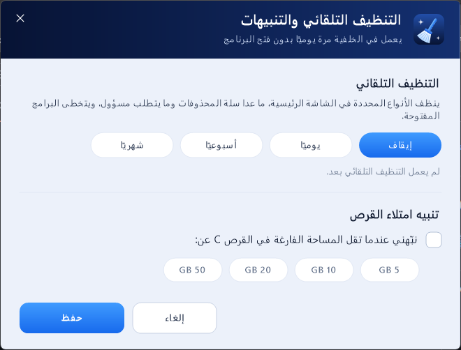

<div dir="rtl">

# Midad Cach Cleaner

**نظامك أنظف ... أداء أسرع**

برنامج ويندوز يحذف الملفات المؤقتة والكاش بأمان، ويوفر مساحة على القرص C. ملفاتك الشخصية ومشاريعك وكلمات المرور لا تُلمس.


## التحميل

من صفحة [**آخر إصدار**](https://github.com/midad1ar/Midad-Cach-Cleaner-Releases/releases/latest) حمّل أحد الملفين:

| الملف | الاستخدام |
|---|---|
| `MidadCachCleaner-Setup.exe` | مثبّت: يضيف البرنامج لقائمة ابدأ وسطح المكتب، ويمكن إزالته من إعدادات ويندوز ← التطبيقات. لا يحتاج صلاحيات مسؤول. |
| `MidadCachCleaner-Portable.exe` | نسخة محمولة تعمل مباشرة بدون تثبيت. |

يعمل على ويندوز 10 و 11 بدون تثبيت أي شيء إضافي (يستخدم .NET Framework 4.8 الموجود في ويندوز).

> عند التشغيل لأول مرة قد يظهر تحذير **Windows protected your PC** لأن البرنامج غير موقّع رقميًا. اضغط **More info** ثم **Run anyway**.

## المميزات

- **فحص وتنظيف 19 فئة من الكاش:** الملفات المؤقتة، كاش كرت الشاشة، Steam، تحديثات ويندوز، تقارير الأعطال، المتصفحات (Chrome / Edge / Brave)، CapCut، Discord، Streamlabs، VS Code، Spotify، Telegram، pip، npm، Gradle، Flutter، NuGet، وسلة المحذوفات.
- **كاش برامج المونتاج والبث:** Adobe Premiere و After Effects (Media Cache وملفات الموجات الصوتية وكاش Camera Raw)، و DaVinci Resolve (CacheClip)، و Filmora، و OBS Studio.
- **تحليل المساحة:** يعرض أكبر المجلدات (مع الدخول إلى داخلها) وأكبر 100 ملف في أي قرص، مع توضيح للملفات المعروفة مثل hiberfil.sys و Windows.old. يعرض فقط ولا يحذف أي شيء.
- **التحقق من التحديثات:** يظهر زر أخضر عند صدور إصدار جديد، ويُحدَّث البرنامج بضغطة واحدة. المثبّت يُنزَّل من هذه الصفحة فقط، ولا يُشغَّل إلا إذا طابقت بصمته SHA-256 البصمة المنشورة.
- **كل الأقراص:** يكتشف الأقراص تلقائيًا ويعرض المساحة الفارغة وحجم الكاش في كل قرص.
- **تنبيه البرامج المفتوحة:** علامة "مفتوح" بجانب البرامج التي تعمل الآن، لأن ملفاتها المستخدمة لا يمكن حذفها.
- **زر إيقاف:** يمكن إيقاف الفحص أو التنظيف في أي لحظة.
- **نقل الكاش إلى قرص آخر:** ينقل كاش Gradle و Hugging Face و pip و npm و NuGet و Flutter إلى قرص آخر، ويوجّه الأدوات للمكان الجديد. يمكن إرجاعه في أي وقت.
- **تنظيف تلقائي:** يومي أو أسبوعي أو شهري في الخلفية، مع تنبيه عندما تقل مساحة القرص C.
- **يتذكر اختياراتك** بين مرة وأخرى.

| تحليل المساحة | نقل الكاش |
|---|---|
|  |  |

| التنظيف التلقائي | المثبّت |
|---|---|
|  |  |

## الأمان

- يحذف **محتوى** مجلدات الكاش المعروفة فقط، ولا يحذف المجلد نفسه.
- لا يتبع الروابط (junctions / symlinks)، فلا يمكن أن يصل لملفات خارج مجلد الكاش.
- يرفض العمل على مجلدات النظام والمستخدم الرئيسية (Windows، Program Files، Documents، سطح المكتب...).
- في مجلد Temp يحذف فقط الملفات الأقدم من يوم.
- الملفات المستخدمة حاليًا يتخطاها بدون أخطاء.
- عند **نقل الكاش**: ينسخ أولًا ثم يتحقق من عدد الملفات وحجمها، ولا يحذف المكان القديم إلا بعد نجاح التحقق.
- التنظيف التلقائي لا يفرّغ سلة المحذوفات، ويتخطى البرامج المفتوحة.
- **تحليل المساحة** يقرأ فقط: لا يحذف ولا ينقل أي ملف، ولا يتبع الروابط.

## الإزالة

من إعدادات ويندوز ← التطبيقات ← **Midad Cach Cleaner** ← إلغاء التثبيت. تُحذف إعدادات البرنامج والمهمة المجدولة، ويبقى أي كاش نقلته في مكانه الجديد.

## التحقق من الملفات

بصمة SHA-256 لكل ملف مكتوبة في صفحة الإصدار. للتحقق في PowerShell:

```powershell
Get-FileHash .\MidadCachCleaner-Setup.exe -Algorithm SHA256
```

</div>

---

**English:** Midad Cach Cleaner is a Windows 10/11 app that safely cleans temp files and app caches (including Adobe, DaVinci Resolve, Filmora and OBS), shows what fills a drive, moves developer caches to another drive, can run on a schedule, and updates itself with SHA-256 verification. Download the installer or the portable exe from the [latest release](https://github.com/midad1ar/Midad-Cach-Cleaner-Releases/releases/latest).
