<div dir="rtl">

# Midad Cach Cleaner

**نظامك أنظف ... أداء أسرع**

برنامج ويندوز يحذف الملفات المؤقتة والكاش بأمان، ويوفر مساحة على القرص C. ملفاتك الشخصية ومشاريعك وكلمات المرور لا تُلمس.

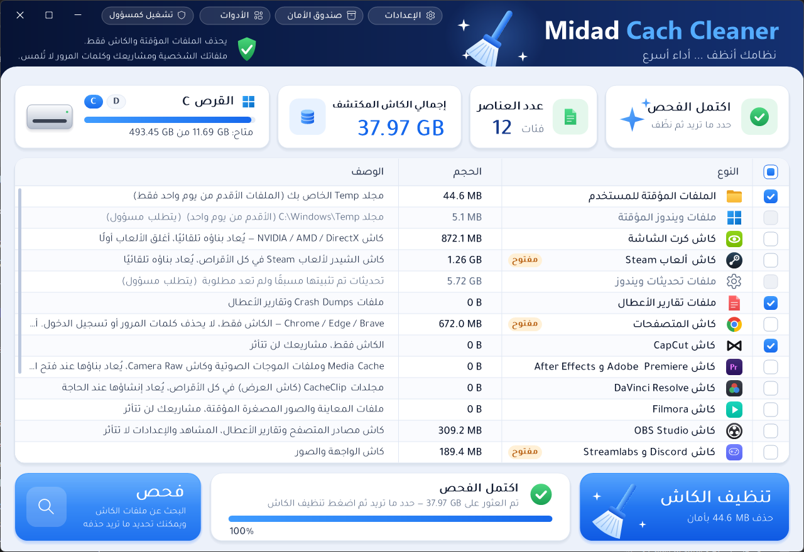

## التحميل

من صفحة [**آخر إصدار**](https://github.com/midad1ar/Midad-Cach-Cleaner-Releases/releases/latest) حمّل الملف `MidadCachCleaner-Setup.exe`.

المثبّت يضيف البرنامج لقائمة ابدأ وسطح المكتب، ويمكن إزالته من إعدادات ويندوز ← التطبيقات. لا يحتاج صلاحيات مسؤول، ويحدّث النسخة المثبتة إن وُجدت.

يعمل على ويندوز 10 و 11 بدون تثبيت أي شيء إضافي (يستخدم .NET Framework 4.8 الموجود في ويندوز).

> عند التشغيل لأول مرة قد يظهر تحذير **Windows protected your PC** لأن البرنامج غير موقّع رقميًا. اضغط **More info** ثم **Run anyway**.

## المميزات

- **فحص وتنظيف 19 فئة من الكاش:** الملفات المؤقتة، كاش كرت الشاشة، Steam، تحديثات ويندوز، تقارير الأعطال، المتصفحات (Chrome / Edge / Brave)، CapCut، Discord، Streamlabs، VS Code، Spotify، Telegram، pip، npm، Gradle، Flutter، NuGet، وسلة المحذوفات.
- **كاش برامج المونتاج والبث:** Adobe Premiere و After Effects (Media Cache وملفات الموجات الصوتية وكاش Camera Raw)، و DaVinci Resolve (CacheClip)، و Filmora، و OBS Studio.
- **تحليل المساحة:** يعرض أكبر المجلدات (مع الدخول إلى داخلها) وأكبر 100 ملف في أي قرص، مع توضيح للملفات المعروفة مثل hiberfil.sys و Windows.old. يعرض فقط ولا يحذف أي شيء.
- **ضغط الألعاب والبرامج:** يضغط مجلدات ألعاب Steam و Epic والبرامج بتقنية الضغط المدمجة في ويندوز (نفس تقنية Compact OS). تعمل الألعاب كما هي، والملفات التي يحدّثها البرنامج تُفك تلقائيًا، ويمكن فك الضغط في أي وقت. يعرض التوفير المتوقع قبل البدء، وكثير من الألعاب الكبيرة يوفّر 10–30%.
- **تنظيف التنزيلات الذكي:** يجد في مجلد التنزيلات:
  - مثبتات لبرامج مثبتة عندك.
  - ملفات zip فككتها بجانبها (يتحقق أن كل ملفاتها موجودة في المجلد).
  - نسخًا مكررة بنفس المحتوى.
  - تنزيلات لم تكتمل، وصور أقراص قديمة.
  - لا يقترح أي ملف يستخدمه مشروع CapCut.
- **مشاريع CapCut:** يقرأ مشاريع CapCut ويجد الفيديوهات والأصوات التي لا يستخدمها إلا مشاريع قديمة أو محذوفة، ومعها سلة المشاريع المحذوفة داخل CapCut.
- **ماذا أكل مساحتي؟** يسجل كل يوم أحجام المجلدات الكبيرة والمساحة الفارغة، ثم يخبرك أي مجلد كبر هذا الأسبوع أو الشهر، ويتوقع متى سيمتلئ القرص بهذا المعدل. ويمكنه تنبيهك قبل أسبوع من امتلاء القرص.
- **بقايا البرامج المحذوفة:** يجد مجلدات AppData و ProgramData لبرامج لم تعد مثبتة. يقارن أسماءها بقائمة البرامج وقائمة ابدأ و Program Files وتطبيقات المتجر، ولا يقترح إلا ما لم يتغير منذ شهرين على الأقل.
- **المشاريع القديمة:** يجد node_modules و build و bin/obj و .venv ومعاينات Premiere وكاش DaVinci داخل مشاريع البرمجة والمونتاج. لا يعتبر المجلد قابلًا للحذف إلا إذا وجد ملف المشروع بجانبه، مثل package.json أو pubspec.yaml أو .csproj.
- **صندوق الأمان:** ما تحذفه من بقايا البرامج والمشاريع القديمة يُنقل أولًا إلى صندوق على نفس القرص، وهو نقل فوري بدون نسخ. يمكنك استرجاعه بضغطة، ثم يُحذف تلقائيًا بعد المدة التي تختارها (3 أو 7 أو 14 أو 30 يومًا). ويمكن تفعيله لتنظيف الكاش أيضًا.
- **صفحة الإعدادات:** فيها التنظيف التلقائي والتنبيهات وصندوق الأمان وتتبع المساحة، والفحص والتحقق من التحديثات عند الفتح.
- **التحقق من التحديثات:** يظهر زر أخضر عند صدور إصدار جديد. المثبّت يُنزَّل من صفحة الإصدارات الرسمية فقط، ولا يُشغَّل إلا إذا طابقت بصمته SHA-256 البصمة المنشورة.
- **كل الأقراص:** يكتشف الأقراص تلقائيًا ويعرض المساحة الفارغة وحجم الكاش في كل قرص.
- **تنبيه البرامج المفتوحة:** علامة "مفتوح" بجانب البرامج التي تعمل الآن، لأن ملفاتها المستخدمة لا يمكن حذفها.
- **زر إيقاف:** يمكن إيقاف الفحص أو التنظيف في أي لحظة.
- **نقل الكاش إلى قرص آخر:** ينقل كاش Gradle و Hugging Face و pip و npm و NuGet و Flutter إلى قرص آخر، ويوجّه الأدوات للمكان الجديد. يمكن إرجاعه في أي وقت.
- **تنظيف تلقائي:** يومي أو أسبوعي أو شهري في الخلفية، مع تنبيه عندما تقل مساحة القرص C أو عندما يقترب امتلاؤه.
- **يتذكر اختياراتك** بين مرة وأخرى.

| الأدوات | ضغط الألعاب والبرامج |
|---|---|
| 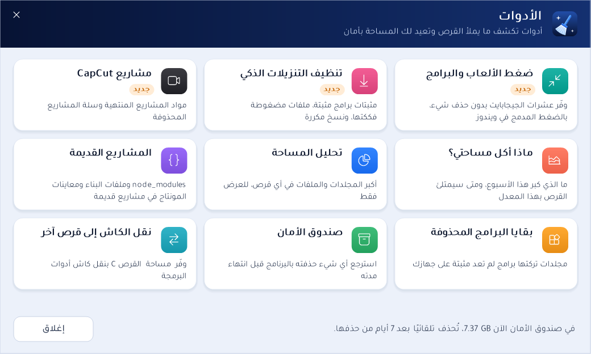 | 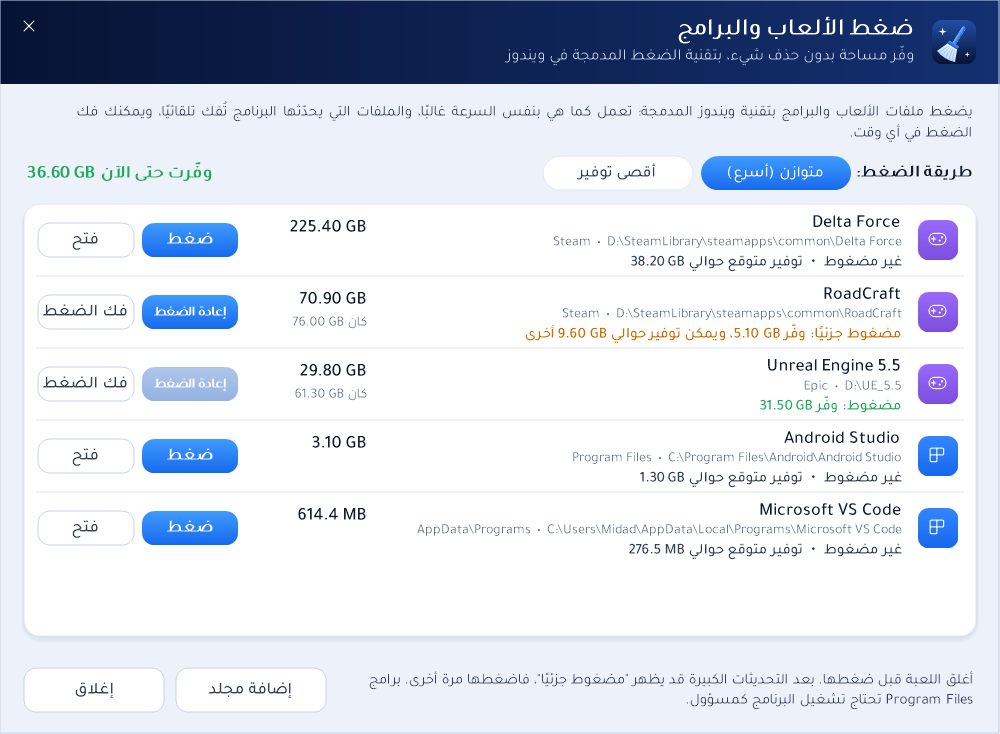 |

| تنظيف التنزيلات الذكي | مشاريع CapCut |
|---|---|
| 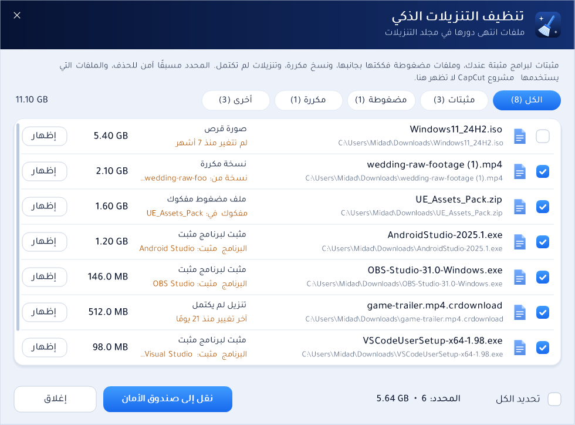 | 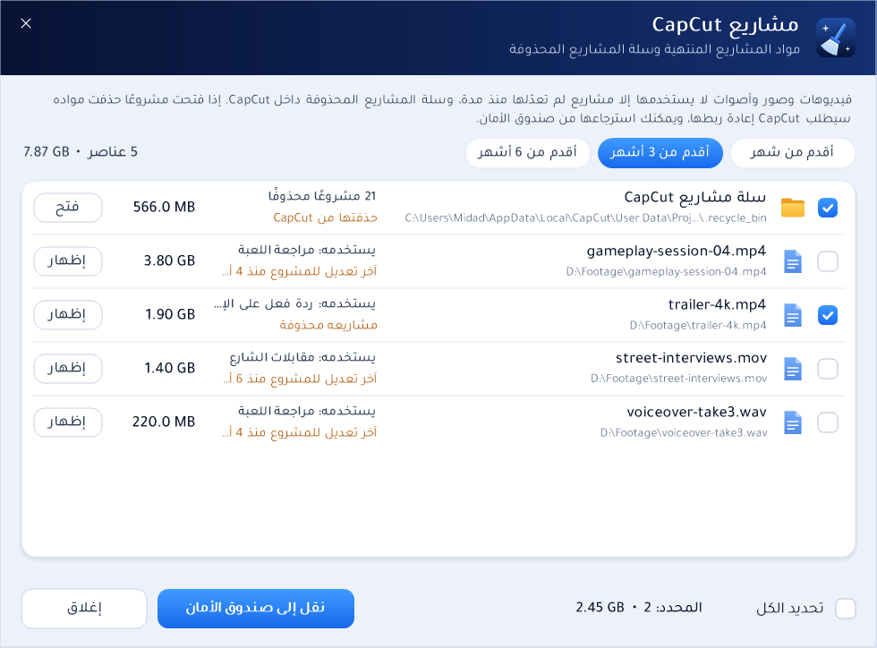 |

| ماذا أكل مساحتي؟ | صندوق الأمان |
|---|---|
| 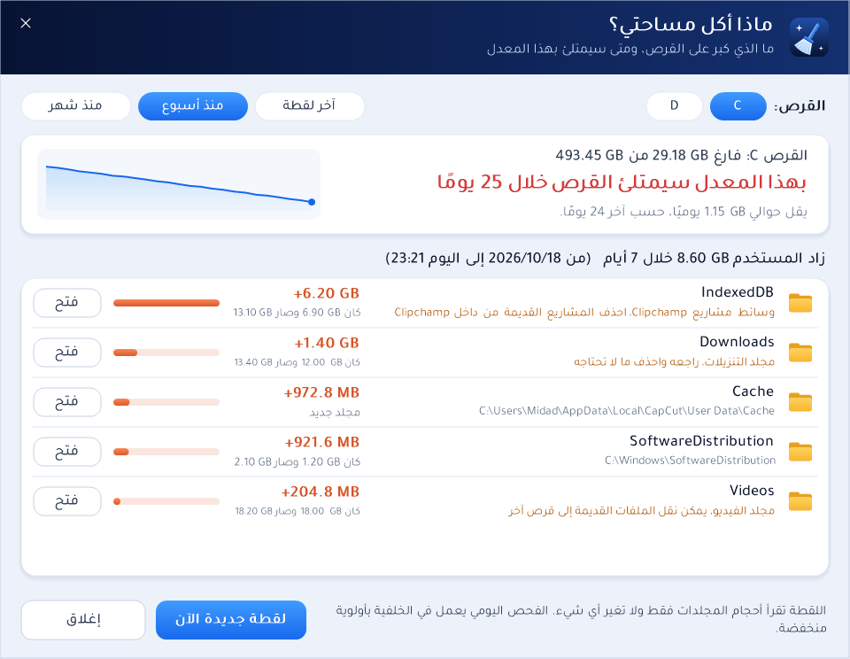 | 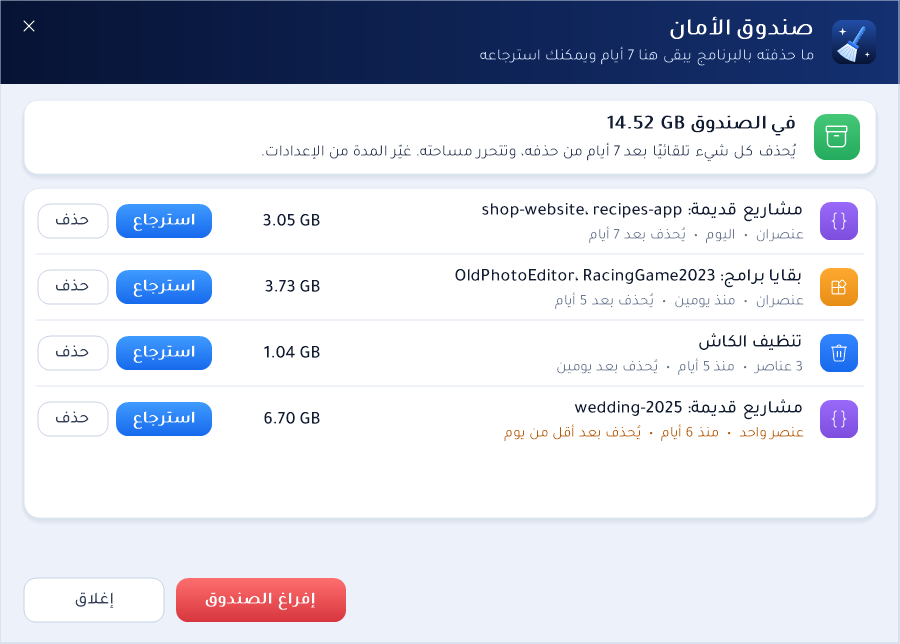 |

| المشاريع القديمة | بقايا البرامج المحذوفة |
|---|---|
|  | 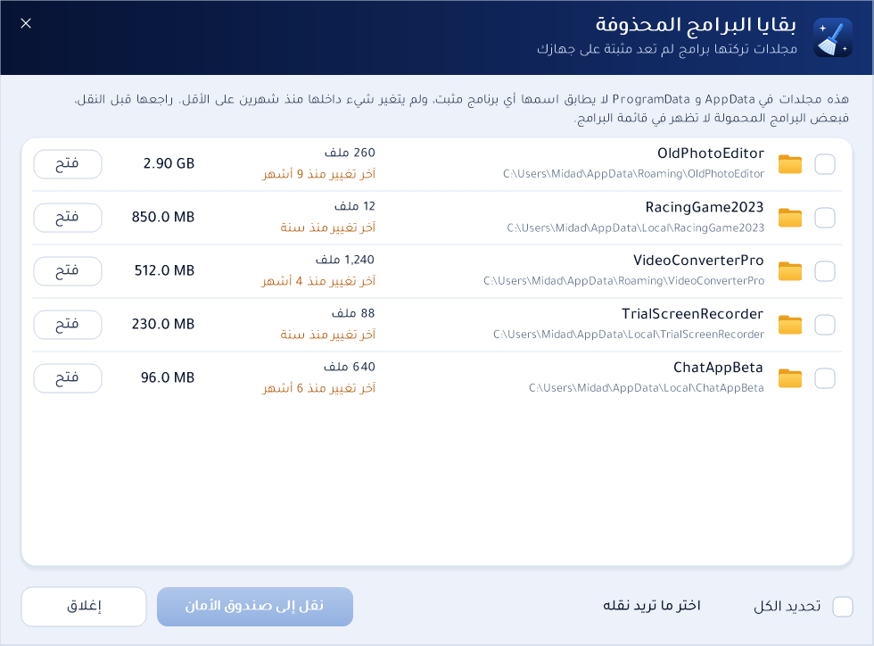 |

| الإعدادات | المثبّت |
|---|---|
| 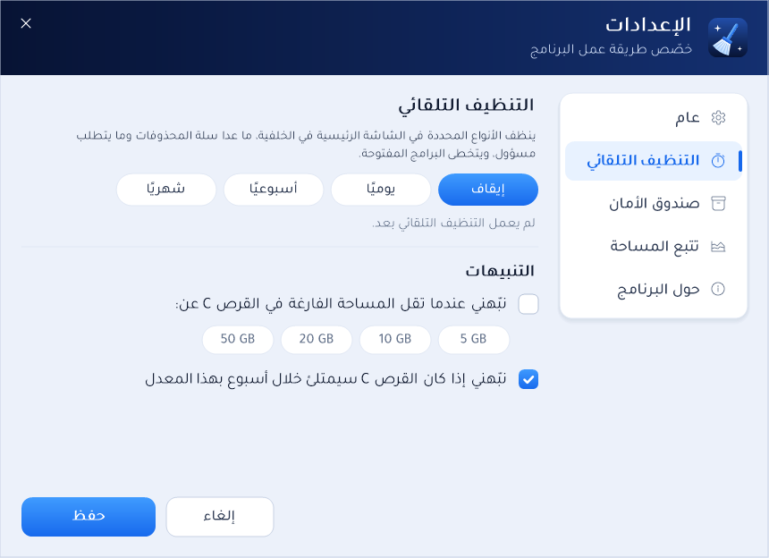 | 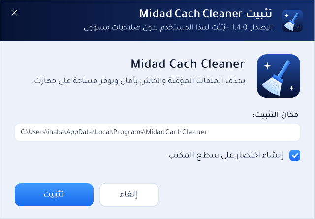 |

| تحليل المساحة | نقل الكاش |
|---|---|
| 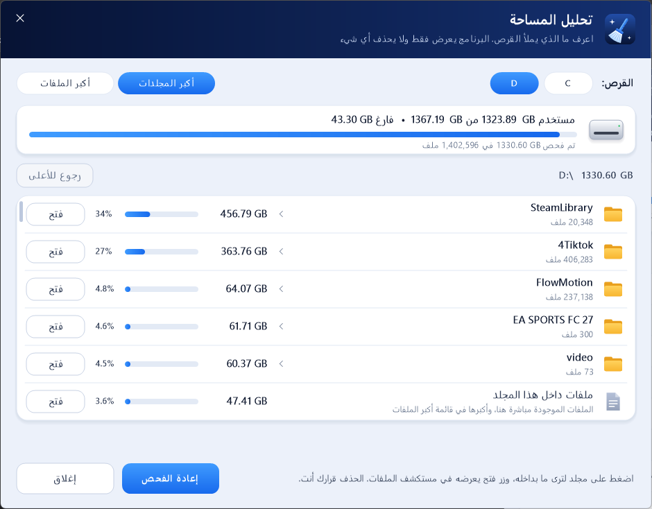 | 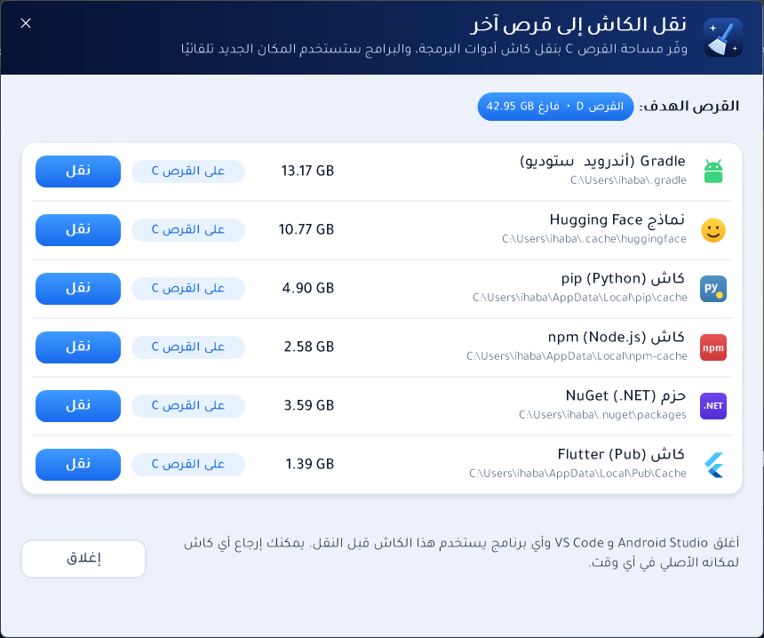 |

صور الأدوات الجديدة فيها بيانات تجريبية.

## الأمان

- يحذف **محتوى** مجلدات الكاش المعروفة فقط، ولا يحذف المجلد نفسه.
- لا يتبع الروابط (junctions / symlinks)، فلا يمكن أن يصل لملفات خارج مجلد الكاش.
- يرفض العمل على مجلدات النظام والمستخدم الرئيسية (Windows، Program Files، Documents، سطح المكتب...).
- في مجلد Temp يحذف فقط الملفات الأقدم من يوم.
- الملفات المستخدمة حاليًا يتخطاها بدون أخطاء.
- عند **نقل الكاش**: ينسخ أولًا ثم يتحقق من عدد الملفات وحجمها، ولا يحذف المكان القديم إلا بعد نجاح التحقق.
- التنظيف التلقائي لا يفرّغ سلة المحذوفات، ويتخطى البرامج المفتوحة.
- بقايا البرامج والمشاريع القديمة لا تُحذف مباشرة: تُنقل إلى صندوق الأمان ويمكن استرجاعها حتى انتهاء المدة. وعند إفراغ الصندوق تُحذف الروابط كروابط، ولا يُلمس ما تشير إليه.
- ضغط الألعاب والبرامج لا يغير محتوى أي ملف، ويمكن فكه في أي وقت. لا يعمل على مجلد ويندوز أو جذر القرص أو مجلد المستخدم أو OneDrive، ولا يتبع الروابط. وقبل فك الضغط يتأكد أن على القرص مساحة كافية.
- تنظيف التنزيلات ومشاريع CapCut ينقلان الملفات إلى صندوق الأمان، ولا يحددان مسبقًا إلا ما هو آمن. ولا تُنقل ملفات CapCut وهو مفتوح.
- تتبع المساحة يقرأ الأحجام فقط، ويعمل في الخلفية بأولوية منخفضة. وسجله محفوظ على جهازك فقط.

## الإزالة

من إعدادات ويندوز ← التطبيقات ← **Midad Cach Cleaner** ← إلغاء التثبيت. تُحذف إعدادات البرنامج والمهمة المجدولة وسجل تتبع المساحة، **ويُفرَّغ صندوق الأمان**، فاسترجع منه ما تريده قبل الإزالة. ويبقى أي كاش نقلته في مكانه الجديد، وتبقى الألعاب المضغوطة مضغوطة وتعمل كما هي.

## التحقق من الملفات

بصمة SHA-256 لكل ملف مكتوبة في صفحة الإصدار. للتحقق في PowerShell:

```powershell
Get-FileHash .\MidadCachCleaner-Setup.exe -Algorithm SHA256
```

</div>

---

**English:** Midad Cach Cleaner is a Windows 10/11 app that safely cleans temp files and app caches (including Adobe, DaVinci Resolve, Filmora and OBS), shows what fills a drive, tracks which folders grow and predicts when a drive will be full, compresses games and programs with Windows' built-in transparent compression, cleans finished files from Downloads (installed installers, extracted archives, duplicates), finds media of old CapCut projects, finds leftovers of uninstalled programs and re-creatable folders in old projects (node_modules, build, previews), keeps everything it removes in an undoable safety box, moves developer caches to another drive, can run on a schedule, and updates itself with SHA-256 verification. Download the installer from the [latest release](https://github.com/midad1ar/Midad-Cach-Cleaner-Releases/releases/latest).
